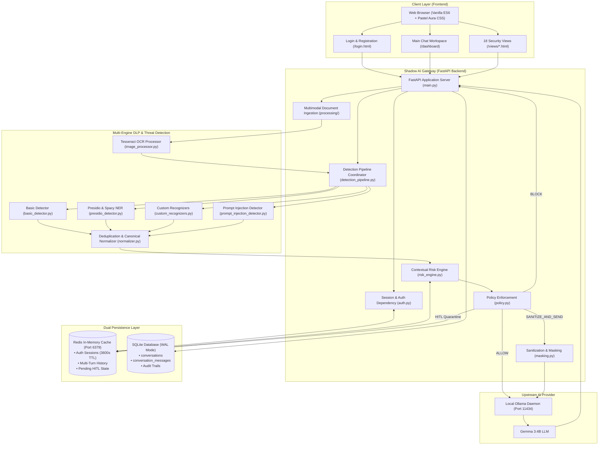
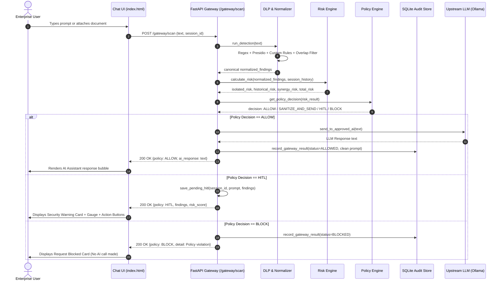
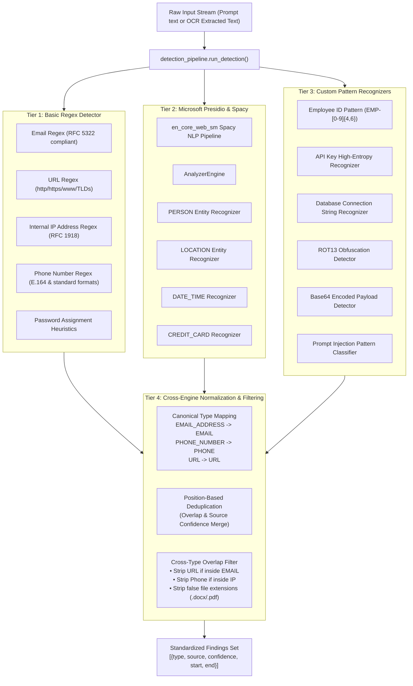
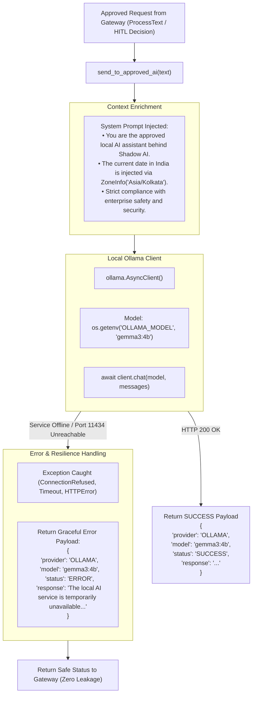
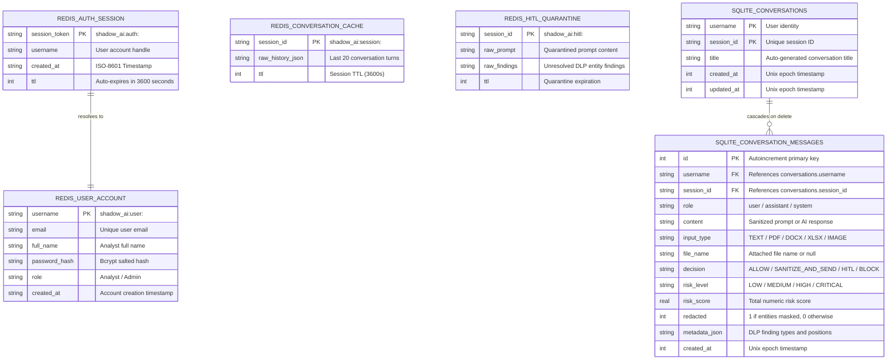
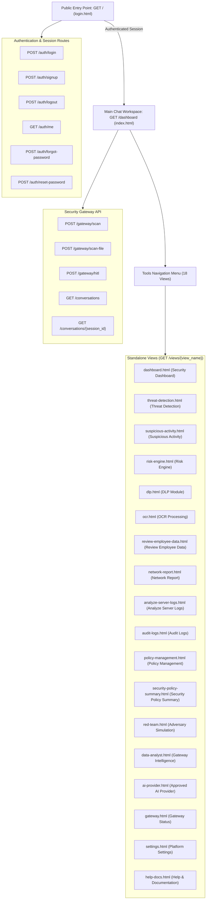

# Shadow AI — Comprehensive System Architecture & Data Flow

**Document:** Architecture Specification
**Project:** Shadow AI — Enterprise AI Security Gateway & Reverse Proxy
**Current Branch:** `redesign/pastel-aura`
**Author:** Senior Full-Stack Software Architect & Cybersecurity Auditor
**Date:** November 23, 2026

---

## 1. System Overview

Shadow AI operates as an inline, stateful Security Gateway and Data Loss Prevention (DLP) reverse proxy designed to govern interactions between corporate users and upstream Large Language Models (LLMs). Rather than allowing enterprise users to communicate directly with external or internal AI services, all requests—whether plain text or file uploads (PDF, DOCX, XLSX, PPTX, Images)—are routed through Shadow AI's multi-tier inspection pipeline.

The platform provides:
1. **Multi-Engine DLP Inspection**: Combines pattern-based regular expressions, Microsoft Presidio NER (Named Entity Recognition), Spacy linguistic analysis, custom recognizers, and OCR document processing.
2. **Contextual & Stateful Risk Scoring**: Evaluates not only the current prompt's isolated sensitivity, but also historical risk decaying over multiple conversation turns ($\lambda = 0.8$) and multi-entity synergy amplification ($\alpha = 1.5$).
3. **Adaptive Policy Enforcement**: Automatically permits low-risk queries (`ALLOW`), redacts and masks sensitive entities (`SANITIZE_AND_SEND`), quarantines ambiguous requests for Human-in-the-Loop review (`HITL`), or outright drops malicious injections (`BLOCK`).
4. **Dual Data Persistence**: Utilizes Redis for sub-millisecond session authentication, TTL tokens, and active turn cache, alongside an append-only SQLite store with WAL (Write-Ahead Logging) for tamper-evident conversation logs and audit trails.

---

## 2. Architecture Diagrams

### Diagram 1: Overall System Architecture



---

### Diagram 2: Authentication & Session Lifecycle

```mermaid
sequenceDiagram
    autonumber
    actor User as Security Analyst
    participant Browser as Web Browser (login.html)
    participant AuthAPI as FastAPI /auth/*
    participant Redis as Redis Cache (Port 6379)
    participant Chat as Workspace (/dashboard)

    User->>Browser: Enters username/email & password
    Browser->>AuthAPI: POST /auth/login {login, password}
    AuthAPI->>Redis: HGET shadow_ai:user:<username>
    Redis-->>AuthAPI: User record + bcrypt password_hash
    AuthAPI->>AuthAPI: bcrypt.checkpw(password, password_hash)
    alt Invalid Credentials
        AuthAPI-->>Browser: 401 Unauthorized {"detail": "Invalid credentials."}
        Browser->>User: Displays inline validation alert
    else Valid Credentials
        AuthAPI->>AuthAPI: secrets.token_urlsafe(48) -> session_token
        AuthAPI->>Redis: HSET shadow_ai:auth:<token> {username, created_at}
        AuthAPI->>Redis: EXPIRE shadow_ai:auth:<token> 3600
        AuthAPI-->>Browser: 200 OK + Set-Cookie: shadow_ai_auth=<token>; HttpOnly; SameSite=Lax
        Browser->>Browser: Redirects to /dashboard
    end

    User->>Browser: Loads /dashboard
    Browser->>AuthAPI: GET /auth/me (Cookie: shadow_ai_auth=<token>)
    AuthAPI->>Redis: HGET shadow_ai:auth:<token>
    Redis-->>AuthAPI: Session data (valid)
    AuthAPI->>Redis: HGET shadow_ai:user:<username>
    Redis-->>AuthAPI: Full profile {full_name, role, email}
    AuthAPI-->>Browser: 200 OK {user: {name, role, email}}
    Browser->>Chat: Renders workspace avatar & user role
```

---

### Diagram 3: Main Chat & Prompt Gateway Pipeline



---

### Diagram 4: Multi-Layered DLP Detection Engine



---

### Diagram 5: Policy Decision Tree & Risk Scoring Matrix

```mermaid
flowchart TD
    Findings["Normalized Findings"] --> IsolatedCalc["1. Isolated Risk Calculation
Risk_iso = Σ (Entity_Weight × Confidence)"]

    subgraph EntityWeights["Entity Weight Catalog (ENTITY_WEIGHTS)"]
        W1["DATABASE_CREDENTIAL: 100.0"]
        W2["API_KEY_LIKE: 90.0 | CREDIT_CARD: 90.0"]
        W3["PASSWORD: 80.0"]
        W4["EMPLOYEE_ID: 30.0 | IP_ADDRESS: 30.0"]
        W5["EMAIL: 20.0 | PHONE: 20.0 | URL: 20.0 | INJECTION: 20.0"]
        W6["PERSON: 10.0 | DATE_TIME: 0.0"]
    end

    IsolatedCalc --> HistoryFetch["2. History Fetch from Redis (Past Turns)"]
    HistoryFetch --> HistoricalCalc["3. Historical Decay Calculation
Risk_hist = Σ (λ^(N-i) × Turn_Risk) | λ = 0.8"]

    HistoricalCalc --> SynergyCalc["4. Synergy Risk Calculation
Risk_syn = α × 10.0 | α = 1.5
(Triggers when sensitive pairs co-occur:
e.g. EMAIL + PASSWORD or IP + API_KEY)"]

    SynergyCalc --> TotalRisk["5. Total Contextual Risk Score
Risk_total = Risk_iso + Risk_hist + Risk_syn"]

    TotalRisk --> ThresholdCheck{"Evaluate Thresholds"}

    ThresholdCheck -->|Risk_total <= 10.0 (TAU_LOW)| ActionAllow["ALLOW (Forward)
• Low risk request
• Forward clean prompt to AI"]
    ThresholdCheck -->|10.0 < Risk_total <= 25.0 (TAU_HITL)| ActionHITL["HITL (Quarantine)
• Medium/High sensitivity
• Prompt analyst for human decision"]
    ThresholdCheck -->|Risk_total > 25.0| ActionBlockOrReview["BLOCK / CRITICAL HITL
• High risk sensitive data
• Password/Credentials detected
• Drop request or require supervisor review"]
```

---

### Diagram 6: AI Provider Upstream Forwarding & Fallback



---

### Diagram 7: Dual-Database Workflow & Schema Relationships



---

### Diagram 8: Application Sitemap & Routing Topology


